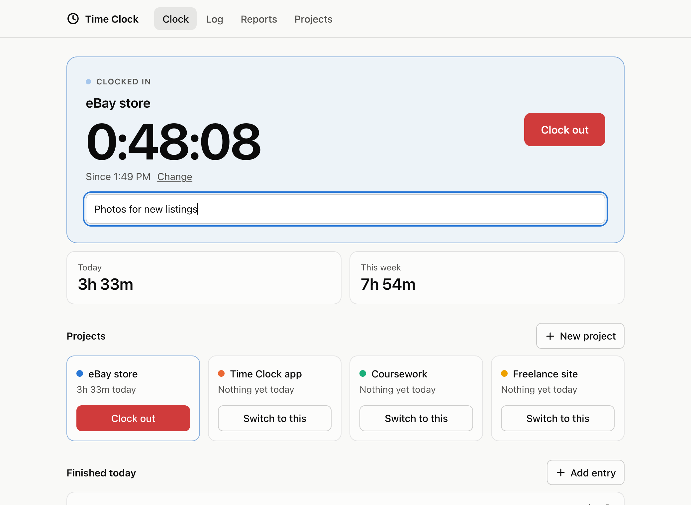
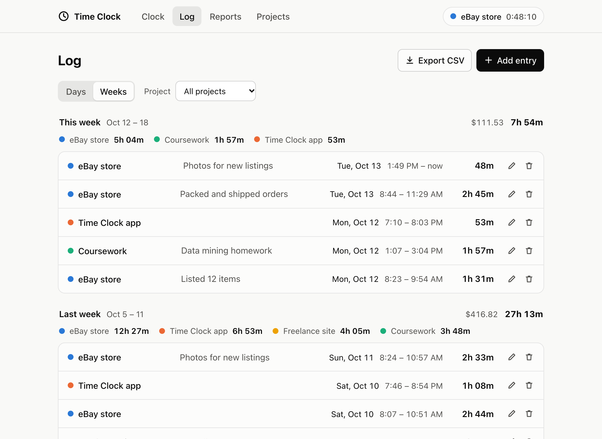
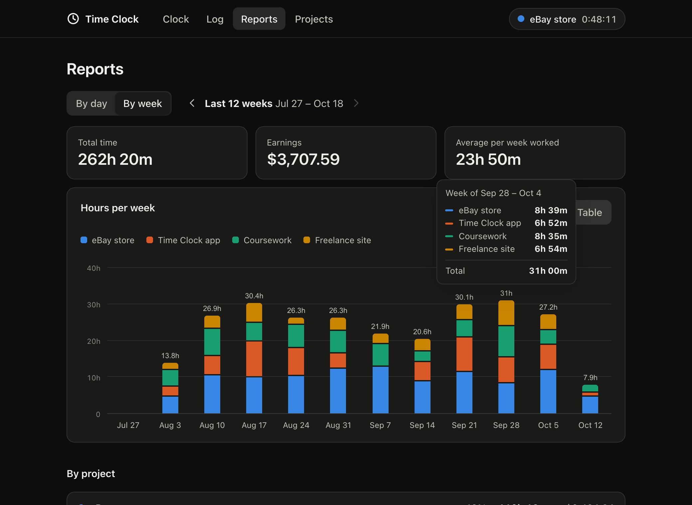

# Time Clock

A personal time clock that runs on your own computer. Clock in to a project, clock out when you're done, and see where your hours went by day, by week and by project.



| Log, grouped by week | Reports, in dark mode |
| --- | --- |
|  |  |

## What it does

- **Clock in and out** of any project with one click. Only one clock runs at a time: clocking in to another project clocks you out of the current one at the same moment.
- **Log** of every entry, grouped by day or by week, with a total for each group and for each project in it.
- **Reports** with a chart of hours per day or per week, the same numbers as a table, and a breakdown by project.
- **Edit or add entries by hand** for the times you forgot to clock in or out. Entries are not allowed to overlap, so an hour is never counted twice.
- **Notes** on each entry, and an optional **hourly rate** per project to see what your time is worth.
- **CSV export** that opens in Excel, Numbers or Google Sheets.
- Light and dark mode, works at phone width, and every control works from the keyboard.

## Run it

You need [Node.js](https://nodejs.org) 22.13 or newer (built and tested on Node 26).

```sh
npm install
npm start
```

Then open <http://localhost:4747>.

Your hours are saved in `data/timeclock.db`. That one file is your whole record: copy it somewhere safe to back it up. It is left out of git on purpose, so your hours never end up on GitHub.

Other commands:

| Command | What it does |
| --- | --- |
| `npm run demo` | Starts the app at <http://localhost:4748> with ten weeks of made-up sample data. Nothing is saved, and your real hours are not touched. |
| `npm test` | Runs the tests. |
| `npm run dev` | Like `npm start`, but restarts the server whenever a server file changes. |

## How it works

There are three parts, and each one only talks to the one next to it:

```
Browser page             Server                    Database
public/          <-->    server/app.js     <-->    data/timeclock.db
what you see     JSON    the rules         SQL     the record
```

1. **The page** (`public/`) is plain HTML, CSS and JavaScript. It has no data of its own. It asks the server for what to show.
2. **The server** (`server/`) is a small [Express](https://expressjs.com) program running on your computer. It checks every request, applies the rules (one clock at a time, no overlapping entries) and reads or writes the database.
3. **The database** is a single [SQLite](https://sqlite.org) file, read and written through Node's built-in `node:sqlite` module.

### Following one click

Here is what happens when you press **Clock in** on a project:

1. The button in the page is `<button data-action="clock-in" data-id="1">`. One click listener in `public/js/app.js` sees the click, looks up the action named `clock-in`, and runs it.
2. That action (in `public/js/views/clock.js`) calls `api.clockIn(1)`, which sends `POST /api/timer/start` with `{ "projectId": 1 }`.
3. In `server/app.js` the matching route checks the id and calls `store.clockIn(1, now)`.
4. `clockIn` in `server/db.js` stops the running entry if there is one, then inserts a new row with a start time and no end time. Both steps happen in one transaction, so they succeed or fail together.
5. The server answers with the new entry. Back in the page, `refresh()` fetches the current data again and redraws the tab.

The clock on screen is not a counter. The page knows when the entry started and shows "now minus start" once a second, so closing the tab or restarting the computer does not stop your clock.

## Project layout

```
server/
  server.js     starts everything (npm start)
  app.js        the web server and its API routes
  db.js         the database: tables, queries, and the clock rules
  validate.js   checks what the browser sends
  errors.js     the error type used for messages shown to the user
public/
  index.html    the page shell and the pop-up forms
  styles.css    all styling, light and dark
  js/
    app.js      runs actions, redraws the page, ticks the clock
    api.js      one function per server request
    state.js    what the page currently knows
    actions.js  actions shared by every tab
    dialogs.js  the pop-up forms
    html.js     templating helper that escapes text
    time.js     dates and durations
    summary.js  totals and grouping by day or week
    chart.js    the bar chart, its table and its tooltip
    csv.js      CSV export
    views/      one file per tab: clock, log, reports, projects
scripts/
  demo.js       the sample-data demo (npm run demo)
test/           tests for the database, the API and the calculations
```

## The API

All requests and answers are JSON. Times are milliseconds since 1970 (UTC).

| Method | Address | What it does |
| --- | --- | --- |
| GET | `/api/projects` | Every project, with its total time and number of entries |
| POST | `/api/projects` | Create a project |
| PATCH | `/api/projects/:id` | Rename, recolor, set the rate, archive or restore |
| DELETE | `/api/projects/:id` | Delete a project and its entries |
| GET | `/api/timer` | The running entry, or `null` |
| POST | `/api/timer/start` | Clock in to a project (clocks out of the current one first) |
| POST | `/api/timer/stop` | Clock out |
| GET | `/api/entries?from=&to=&projectId=` | Entries that started in a time range |
| POST | `/api/entries` | Add a finished entry by hand |
| PATCH | `/api/entries/:id` | Edit an entry |
| DELETE | `/api/entries/:id` | Delete an entry |

## Decisions worth knowing about

- **The database enforces "one clock at a time".** A unique index allows only one entry without an end time, so even a bug in the server code could not leave two clocks running.
- **Times are stored in UTC and grouped in the browser.** The server never decides what "today" or "this week" means. The page does, in your time zone, which keeps the server correct if it ever runs somewhere else.
- **An entry belongs to the day it started.** An entry from 11 PM to 1 AM counts fully toward the day it began, in the log and in the reports.
- **Entries may overlap by under a minute.** Clocked times are exact to the millisecond but the edit form works in whole minutes, so a strict rule would reject honest edits.
- **Changing a project's hourly rate changes its past earnings too.** Earnings are worked out from the current rate, not stored per entry.
- **Money is stored as whole cents**, never as decimals, so sums do not pick up rounding errors.
- **Text is escaped by default.** Views build HTML through one small helper (`html.js`) that escapes every value, so a note containing `<b>` shows as text.
- **The API only answers its own page.** There is no login because the server only listens on this computer, and it refuses requests that come from other websites.
- **One dependency, no build step.** Express is the only package. The page is plain files the browser loads directly.

## Ideas for later

- Host it with a login so it works from a phone
- Start automatically when the computer starts
- Monthly and custom date ranges in reports
- Weekly hour goals per project
